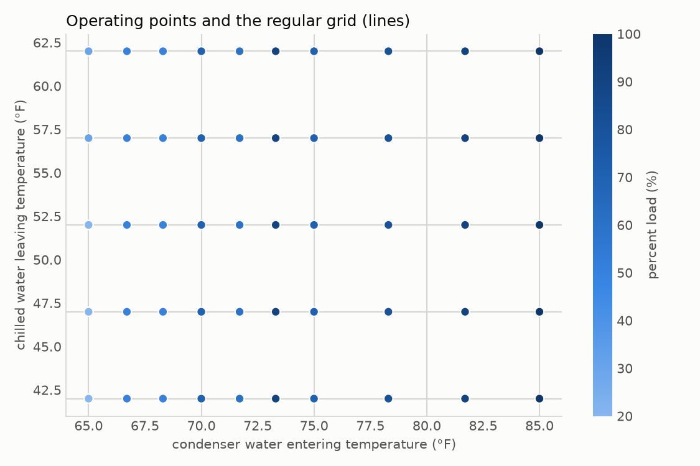
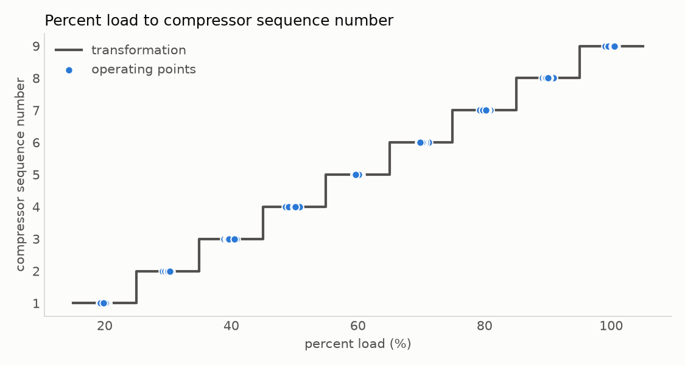

# Chiller: irregular inch-pound operating data to a regular SI map

This example starts from a table of a water-cooled chiller's actual operating points and
translates it into a performance map on a regular grid, in SI units, with load expressed as a
compressor sequence number.

| File | What it is |
|------|------------|
| `chiller_operating_points.csv` | The input: 167 irregular operating points in inch-pound units. |
| `translate_to_regular_map.py` | Builds the map, prints a fit summary, and draws the figures below. |
| `chiller_map_si.csv` | The output: the regular SI map, one row per grid node. |
| `images/` | The figures, written by the script. |

Run it from the repository root:

```
uv run --group examples python examples/chiller/translate_to_regular_map.py
```

## The input

Each row is one operating point, recorded as the chiller ran rather than as it was set:

| Column | Units |
|--------|-------|
| `chilled water flow` | gpm |
| `chilled water leaving temperature` | °F |
| `condenser water flow` | gpm |
| `condenser water entering temperature` | °F |
| `percent load` | % |
| `power` | kW |
| `capacity` | tons of refrigeration |

The units are declared in each column header (for example `power (kW)`), so
`PointTable.from_csv` converts every value to SI as it reads the file.

The points are irregular. The chilled water leaving temperature scatters around four
setpoints. The condenser water entering temperature drifts down as the chiller unloads, so it
rarely repeats. Each run uses one of three flows on each side, and the load steps stop at
different minimum loads, so some combinations were never measured.

The data is synthetic. It was sampled from the public ASHRAE 90.1-2022 Appendix J curve
set F (a 300 to 600 ton liquid-cooled positive displacement chiller), with measurement
scatter and flow effects added.



## The transformations

Every map variable is defined by a transformation: a function that receives one operating
point, with its values already in SI, and returns the variable's value.

- The four flow and temperature grid variables pass the matching input column through. Each
  axis is evenly spaced, stated in inch-pound units through `axis_units` (for example 39 °F
  to 53 °F in 8 steps), and stored in SI.
- `compressor_sequence_number` numbers the 10 % load steps from 1 at 20 % load to 9 at
  full load, rounding each point to its nearest step.
- `input_power` and `net_evaporator_capacity` pass the power and capacity columns through,
  in W. `net_condenser_capacity` is their sum, by energy balance.



## The map

The result is a 3 × 8 × 3 × 6 × 9 grid of 3,888 nodes. Read back by multilinear
interpolation at the input points, it reproduces them with R² ≈ 0.9999. Only 235 nodes fall
inside the convex hull of the data (the smallest region enclosing every point), because five
independent axes leave most of the grid unmeasured. The script prints these counts so you can
judge how much of the map the data supports.


