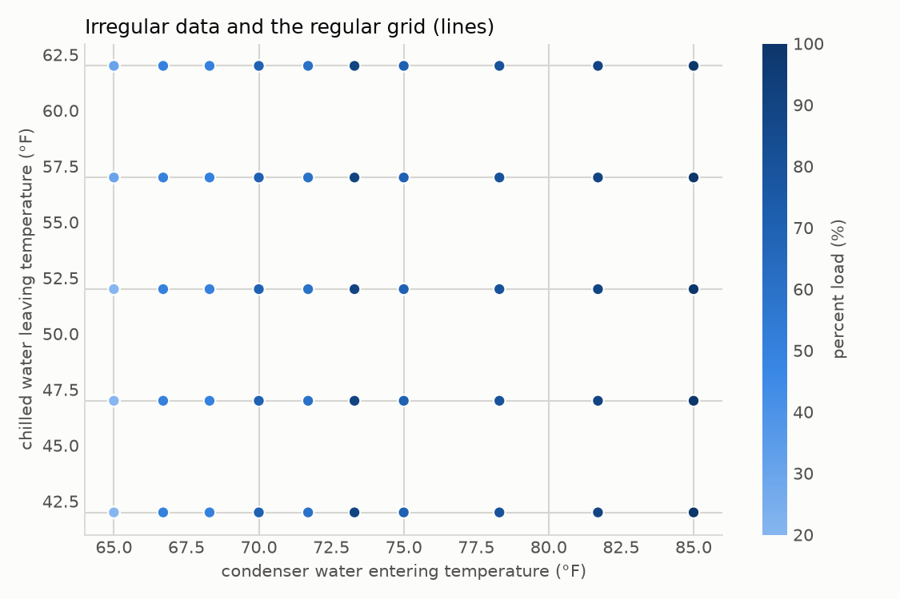
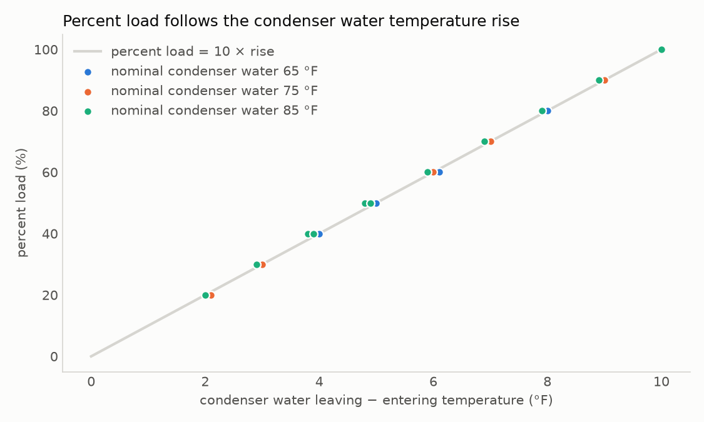
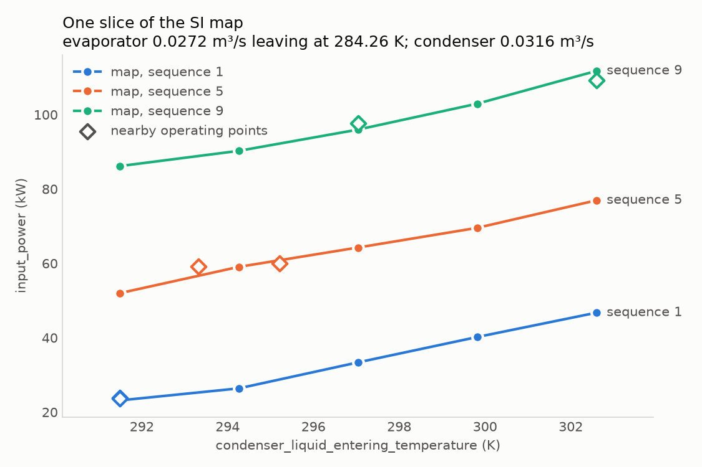
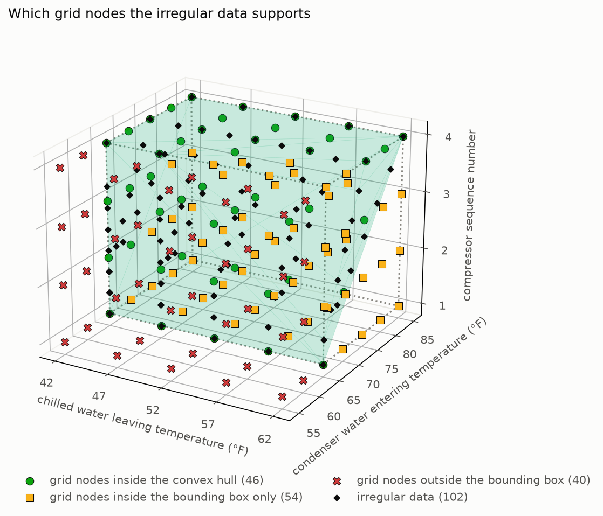

# Chiller: inch-pound operating data to a regular SI map

This example starts from a table of a water-cooled chiller's irregular data, in inch-pound
units, and translates it into a performance map on a regular grid, in SI units, with load
expressed as a compressor sequence number.

| File | What it is |
|------|------------|
| `generate_irregular_data.py` | Writes the synthetic input data. |
| `chiller_irregular_data.csv` | The input: 102 irregular data points in inch-pound units. |
| `translate_to_regular_map.py` | Builds the map, prints a fit summary and a heat-balance check, and draws the figures below. |
| `chiller_map_si.csv` | The output: the regular SI map, one row per grid node. |
| `hull_versus_box.py` | Builds a three-axis map with a widened condenser axis, prints its fit report, and draws which grid nodes the data supports. |
| `images/` | The figures, written by the script. |

Run the scripts from the repository root:

```
uv run --group examples python examples/chiller/generate_irregular_data.py
uv run --group examples python examples/chiller/translate_to_regular_map.py
uv run --group examples python examples/chiller/hull_versus_box.py
```

## The input

Each row is one irregular data point:

| Column | Units |
|--------|-------|
| `chilled water flow` | gpm |
| `chilled water leaving temperature` | °F |
| `chilled water entering temperature` | °F |
| `condenser water flow` | gpm |
| `condenser water entering temperature` | °F |
| `condenser water leaving temperature` | °F |
| `percent load` | % |
| `power` | kW |
| `capacity` | tons of refrigeration |

The units are declared in each column header (for example `power (kW)`), so
`PointTable.from_csv` converts every value to SI as it reads the file.

The data is synthetic. It describes a chiller of about 150 tons with two compressors, laid out
the way chiller selection software reports performance: one run for each pair of design
conditions, and one row for each load step within the run.

- **Design conditions.** Each run holds the chilled water leaving temperature at one of five
  setpoints, 42 °F to 62 °F in 5 °F steps, and starts from one of three nominal condenser
  water entering temperatures, 65 °F, 75 °F, or 85 °F. The 65 °F condenser water is run only
  at the two lowest setpoints, so 12 of the 15 combinations are present.
- **Flows.** Both water flows are sized from the run's full-load capacity for a 10 °F
  temperature difference, and they stay constant as the chiller unloads. Flow is therefore
  different in every run and rises with capacity: about 2.4 gpm per ton on the chilled water
  side, and more on the condenser side, which also carries the compressor's heat.
- **Load steps.** Each run steps from 100 % load down in 10 % steps, to 20 % at the three
  lowest setpoints and to 30 % at the two highest. Runs with 65 °F condenser water skip the
  90 % step.
- **Condenser relief.** As the load falls, the condenser water entering temperature falls in
  a straight line from its nominal value to a floor of 65 °F, which it reaches at 40 % load.
  This is what makes the points irregular. The setpoints sit on a neat grid, but the
  condenser temperatures do not repeat from one run to the next. Because every run ends
  at 65 °F, the missing high-setpoint, cold-condenser runs are hidden in the figure below.



## Percent load to compressor sequence number

The map does not use percent load. It uses a compressor sequence number, which scales load
linearly from 1 at the lowest load measured at a given flow to 4 at full load. Since each
run has its own condenser flow, sequence 1 is that run's minimum load. It is 20 % load at
the three lowest setpoints and 30 % at the two highest:

```
sequence number = 1 + 3 × (load − minimum load at this flow) / (100 % − minimum load at this flow)
```

The sequence number is not rounded, so a point between two whole numbers (for example 2.5)
keeps its exact load. The grid axis holds the four whole numbers 1, 2, 3, and 4, and the map
interpolates between them.

A transformation sees one irregular data point at a time, so the script first collects the
lowest load at each condenser flow (`minimum_load_by_flow`). The sequence number
transformation then looks up the point's flow in that table.

## A check on percent load: the condenser heat balance

The condenser water carries away the heat that the chiller rejects, which is the
evaporator capacity plus the compressor power:

```
condenser flow × volumetric heat capacity of water × (leaving − entering temperature)
    = capacity + power
```

Each run's condenser flow is sized so that the temperature rises 10 °F at full load, and
the flow does not change as the load falls. So the condenser temperature rise divided by
10 °F is nearly the load fraction. Percent load depends on the difference between the two
condenser temperatures, not on either one alone. It departs from a straight line only
because compressor power does not fall exactly in step with load. The script prints this
check. Across all points, percent load ≈ 10.00 × rise + 0.46, with a root-mean-square error
of 0.7 % of load. The heat carried by the water matches capacity plus power to within 2 %.



## The other transformations

Every map variable is defined by a transformation: a function that receives one irregular
data point, with its values already in SI, and returns the variable's value.

- The four flow and temperature grid variables pass the matching input column through. Each
  axis is evenly spaced, stated in inch-pound units through `axis_units` (for example 42 °F
  to 62 °F in 5 steps), and stored in SI. The flow axes run from the lowest to the highest
  flow in the data.
- `input_power` and `net_evaporator_capacity` pass the power and capacity columns through,
  in W. `net_condenser_capacity` is their sum, by energy balance.

## The map

The result is a 3 × 5 × 3 × 5 × 4 grid of 900 nodes. Read back at the irregular data
points, it reproduces them with R² ≈ 0.998.

Only 10 nodes fall inside the convex hull of the data, which is the smallest region
enclosing every point. There are two reasons:
- The two flows are set by each run's full-load capacity, so they move together with the
  chilled water setpoint and the condenser temperature instead of varying on their own.
- Condenser relief means the lowest sequence numbers were only measured with 65 °F condenser
  water.

Everywhere else, the map's values are extrapolated from the data. The script prints these
counts so you can judge how much of the map the data supports.



## When the data does not fill the axes

A performance map often has to cover conditions that the irregular data never reached. For
example, the selection runs above never send condenser water colder than 65 °F, but a chiller
may well see 55 °F water on a cool night. The fit report (requested with `fit_report=True`)
says how much of the grid the data supports, so you can judge which values to trust.

`hull_versus_box.py` shows this on a smaller map with three grid variables: chilled water
leaving temperature (five values, 42 °F to 62 °F), condenser water entering temperature
(seven values, widened to run from 55 °F to 85 °F in 5 °F steps), and compressor sequence
number (1 to 4). The grid has 5 × 7 × 4 = 140 nodes. With three axes the map can be drawn in
three dimensions, and the flow axes, which move together with the other variables, are left
out.



The script also writes [a rotatable version of this figure](images/hull_versus_box.html).
Download it and open it in a browser; it loads the plotly library from the web.

The fit report sorts every grid node into one of three extrapolation zones:

| Zone | Nodes | What a node's value is |
|------|-------|------------------------|
| Inside the convex hull of the data | 46 | Interpolated between data points that surround it. |
| Inside the bounding box, outside the hull (`grid_points_outside_convex_hull`) | 54 | Gap-filling: each coordinate is within the data's range, but this combination of coordinates was never measured. |
| Outside the bounding box (`grid_points_outside_bounding_box`) | 40 | Pure extrapolation: at least one coordinate is beyond the data's range on its axis. |

The bounding box is the range of the data along each axis taken separately, and the convex
hull is the smallest region enclosing every point. The hull always lies inside the box. Here
the hull is a sloped wedge: condenser relief means the lowest sequence numbers were measured
only with 65 °F condenser water, so the box's corner of low sequence numbers and warm
condenser water is outside the hull. The two columns of nodes at 55 °F and 60 °F condenser
water are outside the box altogether.

The other fields of the report:

- `grid_points_outside_convex_hull` and `grid_points_outside_bounding_box` hold the nodes'
  positions in the flattened grid, in the same row-major order as the lookup values, with
  the last grid variable varying fastest. The nodes inside the hull are the ones in neither
  list.
- `grid_variable_coverage` lists each axis's minimum and maximum next to the data's. The
  condenser water entering temperature axis starts at 285.9 K (55 °F) while the data starts
  at 291.5 K (65 °F); the other two axes match the data exactly. An axis that extends past
  the data is what puts nodes outside the bounding box.
- `points_outside_grid` lists the irregular data points that fall beyond an axis's range,
  which is the opposite situation: an axis narrower than the data. There are none here.
  Such points are left out of the error statistics.
- `convex_hull_evaluated` is false when the hull cannot be built, which happens when the data
  lies on a lower-dimensional surface within the grid, for example when one grid variable is
  a fixed function of the others. Then no node is reported outside the hull, and only the
  bounding box test applies.
- `r_squared` and the per-variable statistics (root-mean-square, largest, and mean error)
  compare the map, read back at the irregular data points, with the data. They measure
  whether the grid is fine enough to reproduce the data, so they say nothing about nodes
  away from the data. This map reproduces the data with R² ≈ 0.997, close to the full
  map's 0.998, even though 94 of its 140 nodes are gap-filled or extrapolated.

The full five-axis map above is in a worse position for the reasons given there: only 10 of
its 900 nodes are inside the hull, and the other 890 are gap-filled, although none is
outside the bounding box.
